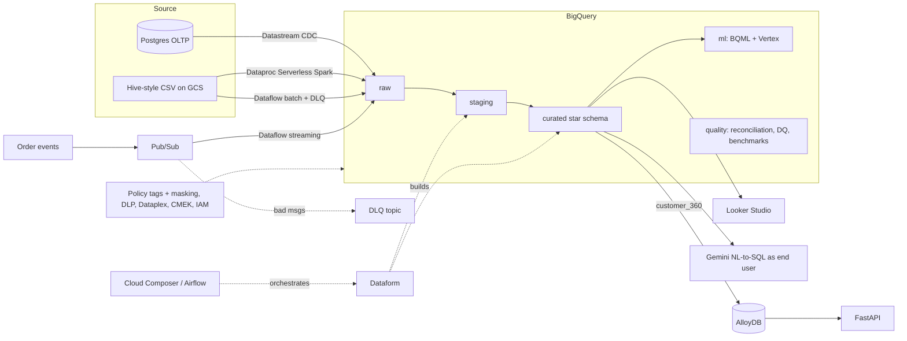

# Legacy-to-GCP Data Warehouse Migration & Modernization Accelerator

A consulting-style engagement in a repo: migrate a retail company's on-prem **Postgres OLTP + Hive-style
warehouse** to **Google Cloud**, prove the migration is correct, govern it, and put ML on top.

> **Status of numbers:** `docs/results.md` contains empty result tables. Fill them with your own measured
> output (`make benchmark`, `make reconcile`, `make dq`). Do not publish numbers you did not measure.

## The problem (customer story)
Reports take minutes, the same revenue number differs between systems, PII is readable by everyone, there is no
lineage, and nobody can prove what was lost in past migrations. Goal: migrate, **reconcile**, govern, speed up, and add churn prediction.

## Architecture


## What's in here
| Area | Path | Highlights |
|---|---|---|
| Source system | `source_system/` | Deterministic generator with deliberate mess (dup customers, 4 date formats, PII, bad rows), Postgres with logical replication, Pub/Sub publisher |
| IaC | `terraform/` | Modules: storage, KMS (CMEK), BigQuery, Pub/Sub, IAM, governance (policy tags, masking, Dataplex DQ), Datastream, AlloyDB, Composer. Expensive modules default **off** |
| Ingestion | `ingestion/` | Spark (bulk), Beam batch (daily drops, dead-letter), Beam streaming (windows, late data, DLQ) |
| Transform | `dataform/` | raw to staging to curated, assertions, star schema, partitioned/clustered fact + **unoptimized baseline**, materialized view, legacy report parity |
| Orchestration | `orchestration/dags/` | Airflow DAG with retries/backoff, SLA, alerts, backfill |
| Validation | `validation/`, `accelerator/reconciliation.py` | Row counts, sums, 60-bit XOR checksum computed identically in Postgres and BigQuery, per-month keyed diffs |
| Quality & governance | `governance/`, `accelerator/dq.py` | SQL rule engine to `quality.dq_scores`, DLP discovery, policy-tag automation |
| ML | `ml/` | BQML logistic regression, TensorFlow on Vertex AI, leakage-free features, batch scoring |
| Serving | `serving/` | AlloyDB customer_360 + FastAPI, latency benchmark vs BigQuery |
| NL to SQL | `nl2sql/` | Gemini generates SQL; executed as end-user identity so policy tags apply |
| Docs | `docs/` | Discovery, 5 ADRs, WBS + risks, workshop outline, runbook, cost guide, results template |

## Quickstart
```bash
export PROJECT_ID=your-project REGION=asia-south1
make setup && source .venv/bin/activate && make test           # 37 unit tests, no cloud needed

# 1. data + source DB
make gen-data ROWS=1000000 && make db-up && sleep 5 && make db-load
# 2. infra (set a billing budget alert FIRST)
cp terraform/terraform.tfvars.example terraform/terraform.tfvars   # edit
make tf-init STATE_BUCKET=<your-state-bucket> && make tf-apply
make upload-legacy
# 3. CDC: expose Postgres to Datastream (Cloud SQL is easiest), run source_system/cdc_setup.sql,
#    then set enable_datastream=true + source_db_* vars and apply.
# 4. batch + transform
make ingest-spark && make ingest-batch
#    create a Dataform repo from ./dataform (set defaultProject), run it, then:
make tag-pii && make reconcile && make dq && make benchmark
# 5. streaming
make stream-job   # then in another shell: make stream-publish
# 6. ML + serving
make bqml && make score          # then: make vertex
make serve
make tf-destroy-expensive        # when finished
```
Full walkthrough: `docs/runbook.md`. Cost control: `docs/cost_control.md`.

## Design decisions (see `docs/adr/`)
1. Datastream for CDC vs custom Debezium
2. Dataflow vs Dataproc Serverless
3. BigQuery vs AlloyDB per workload
4. Dataform vs dbt
5. Composer vs local Airflow (cost)

## Interview narrative
Problem, options weighed, what you chose and why, measured result (bytes scanned, reconciliation pass rate,
DQ score trend, p95 latency AlloyDB vs BigQuery). See `docs/interview_guide.md`.

## Known limitations (be upfront about these)
* Written to deploy as-is but **verify against your project**: provider/API versions drift (container image URIs,
  Gemini model name, Terraform data-policy resources). CI runs `terraform validate` and `dataform compile`.
* Synthetic data; scale is "tens of GB at most" by design.
* Datastream needs a reachable source (Cloud SQL public IP + allow-list, or private connectivity).
